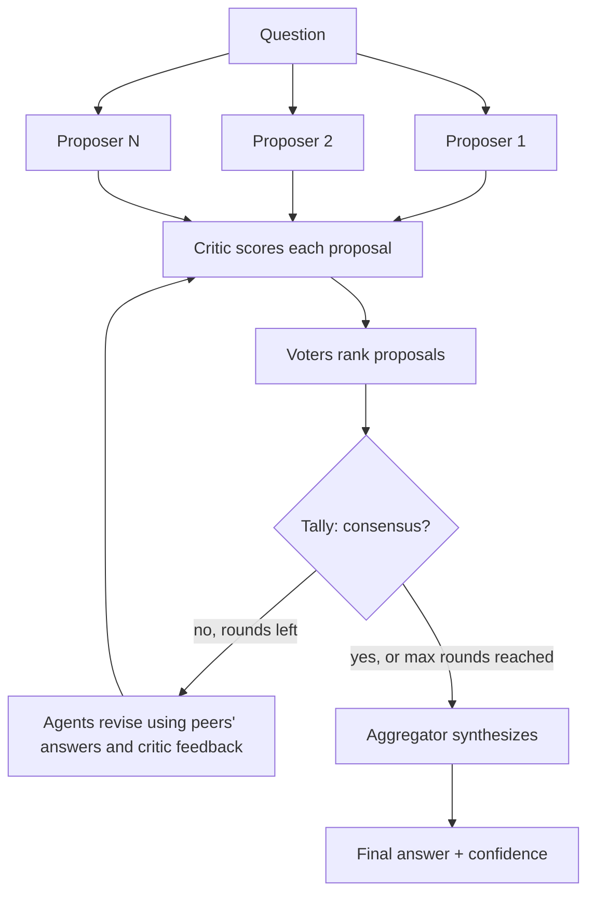

# Multi-Agent Debate System

A swarm of LLM agents that propose, critique, vote and synthesize one answer with an explainable confidence score.

[](https://github.com/imranmali/multi-agent-dDebate-system/actions/workflows/ci.yml)
[](LICENSE)
[](https://www.python.org/downloads/)

## Why a swarm

A single agent answers once and has no way to notice its own blind spots. This project
orchestrates a *swarm*: several agents with distinct personas answer independently and
concurrently, a critic scores every answer, the agents revise and vote, and an aggregator
synthesizes the result. Every number behind the final confidence is reported, so the outcome
can be audited rather than taken on trust.

## How it works



Every agent call within a phase (propose/revise, critique, vote) runs concurrently with
`asyncio`, and each call has a timeout. A failing agent is recorded as an error in that round
and the debate continues with the rest; it fails only when no proposal survives a round.

### Agent roles

| Role | What it does |
|---|---|
| **Proposer / Reviser** | Round 1: answers the question independently using its persona. Later rounds: revises its answer after seeing every peer answer, critic scores and feedback. |
| **Critic** | Scores each proposal 0-10 on correctness, completeness, clarity and feasibility, and writes feedback. Overall score = mean / 10, in `[0, 1]`. Unparseable replies get neutral scores (5) and are flagged `parsed=False`. |
| **Voter** | Each surviving agent ranks the round's proposals best first. Its own proposal is excluded unless `allow_self_vote=True`. |
| **Aggregator** | Runs once after the last round and synthesizes the final answer from the final round and the winning position. If it fails, the winning proposal's answer is used. |

### Voting strategies and consensus

Proposals whose answers are equal after normalization (case-insensitive, collapsed whitespace,
trailing punctuation removed) form one *position*, so agreeing agents do not split the vote.

| Strategy | Points per ballot |
|---|---|
| `plurality` | 1 point for the first choice |
| `borda` | `n - 1 - rank` points for every ranked position |
| `weighted` (default) | Borda points multiplied by the voter's weight: the critic score of its own latest proposal (minimum 0.1) |

Ties break on the higher mean critic score, then on the earliest proposal id.
**Support** is the (weighted, for `weighted`) fraction of ballots whose first choice is the
winning position. **Consensus** is reached when `support >= consensus_threshold` (default 0.6);
the debate stops after the first round that reaches consensus, otherwise after `max_rounds`.

### Confidence

```
confidence = 0.4 * support + 0.3 * quality + 0.2 * agreement + 0.1 * stability
```

| Component | Default weight | Meaning |
|---|---|---|
| `support` | 0.4 | Vote support for the winning position in the final round |
| `quality` | 0.3 | The winner's critic score |
| `agreement` | 0.2 | Size of the largest position / number of proposals |
| `stability` | 0.1 | Fraction of rounds whose winning position equals the final one |

Weights are configurable and normalized to sum to 1; the score is clamped to `[0, 1]` and every
component's value and weight is included in the result. It is a heuristic, not a calibrated
probability.

## Quickstart

```bash
python -m venv .venv
source .venv/bin/activate
pip install -e '.[dev]'

debate "Which database should we use for an event-sourced app?"
debate "Which database should we use for an event-sourced app?" --agents 5 --strategy borda --json
python -m debate_system "Monolith or microservices for a 3-person team?" --seed 7
```

The default `mock` backend is deterministic and fully offline: no API key or network needed, and
the same `--seed` always gives the same debate. It simulates the swarm with canned, generic
stances (it does not read the question), so use it to see the orchestration at work and switch to
`--backend anthropic` for real answers.

### CLI options

```
debate QUESTION [--agents N] [--rounds R] [--threshold T]
                [--strategy plurality|borda|weighted] [--backend mock|anthropic]
                [--model MODEL] [--seed N] [--timeout SECONDS] [--json] [--verbose]
```

| Option | Default | Description |
|---|---|---|
| `--agents` | `3` | Number of proposer agents (at least 2) |
| `--rounds` | `3` | Maximum debate rounds |
| `--threshold` | `0.6` | Vote support needed for consensus, in `(0, 1]` |
| `--strategy` | `weighted` | Voting strategy |
| `--backend` | `mock` | Model backend |
| `--model` | `claude-opus-5-5` | Model id for the `anthropic` backend |
| `--seed` | `0` | Seed for the `mock` backend |
| `--timeout` | `120` | Per-call timeout in seconds |
| `--json` | off | Print the full result as one JSON document |
| `--verbose` | off | Print progress to stderr |

Exit codes: `0` success, `1` debate or backend error, `2` invalid arguments.

## Python API

```python
from debate_system import DebateConfig, DebateOrchestrator, create_backend

orchestrator = DebateOrchestrator(
    create_backend("mock", seed=7),
    DebateConfig(num_agents=4, max_rounds=3),
)
result = orchestrator.run_sync("Which database should we use for an event-sourced app?")
# inside async code: result = await orchestrator.run(question)

print(result.final_answer, result.confidence.score, result.consensus_reached)
result.to_dict()  # JSON-serializable transcript: rounds, proposals, critiques, votes, errors
```

### Using Claude

```bash
pip install 'multi-agent-debate[anthropic]'
export ANTHROPIC_API_KEY=...
debate "Which database should we use?" --backend anthropic            # model claude-opus-5-5
debate "Which database should we use?" --backend anthropic --model <model-id>
```

The `anthropic` SDK is an optional extra and is imported lazily, so the core package has no
runtime dependencies. A paid debate makes up to `rounds x 3 x agents + 1` calls (propose, critique and vote per agent each round, plus one aggregation), which
is why the defaults are small and the debate stops early on consensus.

### Custom backends

Any object with an async `complete` method can drive a debate:

```python
from debate_system import DebateOrchestrator, LLMRequest


class MyBackend:
    async def complete(self, request: LLMRequest) -> str:
        # request.role: "proposer" | "reviser" | "critic" | "voter" | "aggregator"
        # request.system, request.prompt: the text to send to your model
        # request.metadata: structured context (agent id, question, candidates, ...)
        return await call_my_model(request.system, request.prompt)


result = DebateOrchestrator(MyBackend()).run_sync("Your question")
```

Agents ask for JSON replies and parse them tolerantly, with documented fallbacks when a model
returns free text.

## Configuration

`DebateConfig` fields:

| Field | Default | Description |
|---|---|---|
| `num_agents` | `3` | Number of proposer agents (>= 2) |
| `max_rounds` | `3` | Maximum rounds (>= 1) |
| `consensus_threshold` | `0.6` | Support needed for consensus, in `(0, 1]` |
| `voting_strategy` | `"weighted"` | `"plurality"`, `"borda"` or `"weighted"` |
| `allow_self_vote` | `False` | Let agents vote for their own proposal |
| `timeout_seconds` | `120.0` | Per-call timeout (> 0) |
| `personas` | 8 built-in personas | Assigned to proposers in order, reused cyclically |
| `confidence_weights` | `{"support": 0.4, "quality": 0.3, "agreement": 0.2, "stability": 0.1}` | Non-negative; normalized to sum to 1 |

Invalid values raise `ConfigError`, which names the offending field.

## Example output

`debate "Which database should we use for an event-sourced app?" --agents 4 --seed 1` with the offline mock backend: the agents split in round 1, revise toward the best-scored answer and reach consensus in round 2.

```text
Question: Which database should we use for an event-sourced app?
Backend: mock | agents: 4 | strategy: weighted | threshold: 0.60

Round 1
  agent-1   pragmatist       score 0.78  Prioritize correctness and safety over speed of delivery.
  agent-2   skeptic          score 0.72  Choose the most widely adopted, well-documented option.
  agent-3   innovator        score 0.72  Choose the most widely adopted, well-documented option.
  agent-4   analyst          score 0.62  Optimize for long-term scalability from the start.
  -> winner r1-agent-1 | support 0.51 | consensus no

Round 2
  agent-1   pragmatist       score 0.78  Prioritize correctness and safety over speed of delivery.
  agent-2   skeptic          score 0.78  Prioritize correctness and safety over speed of delivery.
  agent-3   innovator        score 0.78  Prioritize correctness and safety over speed of delivery.
  agent-4   analyst          score 0.78  Prioritize correctness and safety over speed of delivery.
  -> winner r2-agent-1 | support 1.00 | consensus yes

Final answer (consensus reached after 2 rounds, winner r2-agent-1):
  Prioritize correctness and safety over speed of delivery.
  4 of 4 candidates from 4 agent(s) supported this answer.

Confidence: 0.93
  support    1.00 x 0.40
  quality    0.78 x 0.30
  agreement  1.00 x 0.20
  stability  1.00 x 0.10
```

## Project layout

```
src/debate_system/
├── __init__.py
├── __main__.py           # python -m debate_system
├── models.py             # shared dataclasses (proposals, critiques, rounds, result)
├── config.py             # DebateConfig + validation
├── parsing.py            # tolerant JSON extraction from model text
├── agents.py             # proposer/reviser, critic, voter, aggregator
├── consensus.py          # positions, voting strategies, consensus rule
├── confidence.py         # confidence score and breakdown
├── orchestrator.py       # DebateOrchestrator round loop
├── cli.py                # `debate` command
└── llm/
    ├── __init__.py       # create_backend() factory
    ├── base.py           # LLMRequest, LLMBackend protocol, BackendError
    ├── mock.py           # deterministic offline backend (default)
    ├── scripted.py       # canned replies for tests
    └── anthropic_backend.py  # Claude backend (optional extra)
tests/                    # pytest suite
openspec/                 # specs and change proposals
```

## Development

```bash
pip install -e '.[dev]'

pytest --cov=debate_system --cov-report=term-missing   # coverage gate: 90%
ruff check . && ruff format --check .                   # lint + format
mypy                                                    # strict type check of src/
```

### Spec-driven workflow (OpenSpec)

Behaviour is specified with [OpenSpec](https://github.com/Fission-AI/OpenSpec) before it is
built. Each change goes through:

**proposal -> specs -> design -> tasks -> apply -> archive**

1. `openspec/changes/<change>/proposal.md` - why and what changes.
2. `openspec/changes/<change>/specs/` - requirement deltas with scenarios.
3. `design.md` - technical decisions; `tasks.md` - implementation checklist.
4. Apply: implement the tasks with tests.
5. Archive: `openspec archive <change>` merges the deltas into the source-of-truth specs in
   `openspec/specs/`.

Validate before pushing:

```bash
openspec validate --all --strict
```

### Git workflow

- Work on feature branches named `feature/*`, merged into `main` with `--no-ff`.
- Commit messages follow [Conventional Commits](https://www.conventionalcommits.org/)
  (`feat(cli): add --timeout option`, `fix(consensus): break ties on critic score`).
- Pull requests to `main` must pass CI.

See [CONTRIBUTING.md](CONTRIBUTING.md) for details.

## CI/CD

- **[`ci.yml`](.github/workflows/ci.yml)** (every push to `main` and every pull request):
  ruff lint and format check, mypy, pytest with the coverage gate on Python 3.10-3.13,
  `openspec validate --all --strict`, sdist/wheel build with `twine check` plus a smoke run of
  the installed wheel, and a Docker image build with an offline smoke run.
- **[`release.yml`](.github/workflows/release.yml)** (push to `main`, `v*` tags, or manual
  run): builds and pushes the container image to GHCR as
  `ghcr.io/imranmali/multi-agent-debate` (tags: branch, semver, short SHA, and `latest` on
  `main`). On `v*` tags it also builds the package and publishes a GitHub Release with the
  sdist and wheel attached and generated release notes.

Run the published image (the offline `mock` backend is the default):

```bash
docker run --rm ghcr.io/imranmali/multi-agent-debate "Which database should we use?"
docker run --rm -e ANTHROPIC_API_KEY ghcr.io/imranmali/multi-agent-debate \
  "Which database should we use?" --backend anthropic --json
```

To cut a release, bump `version` in `pyproject.toml`, update `CHANGELOG.md`, then push a
matching tag (for example `v0.1.0`).

## License

[MIT](LICENSE)
